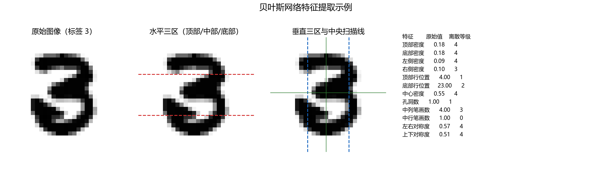
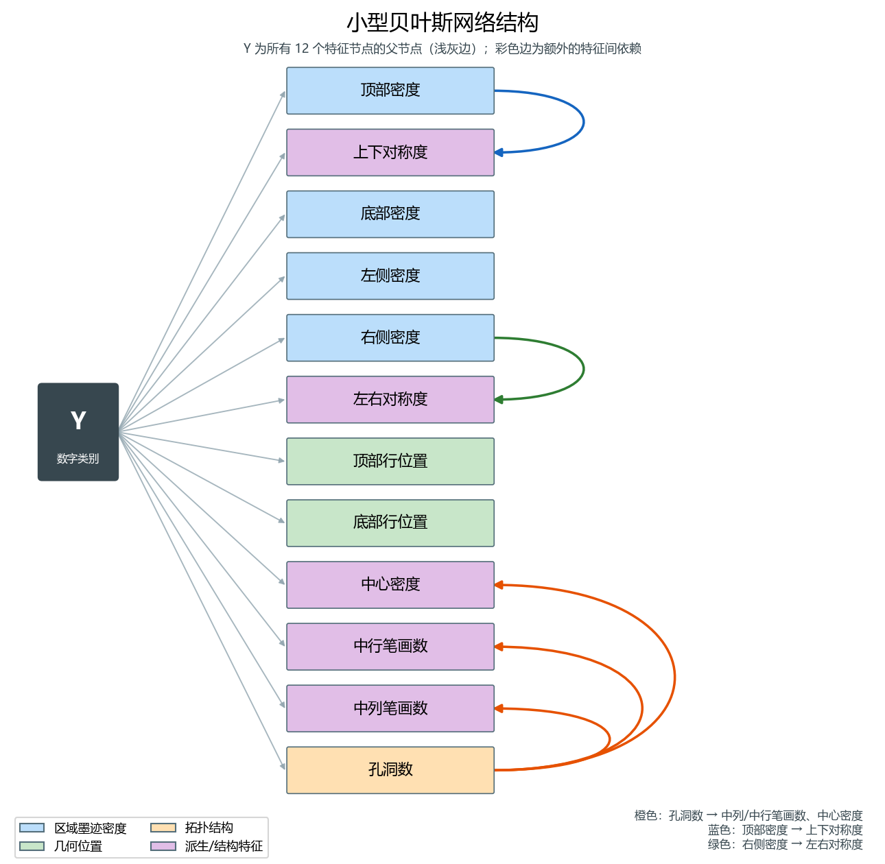
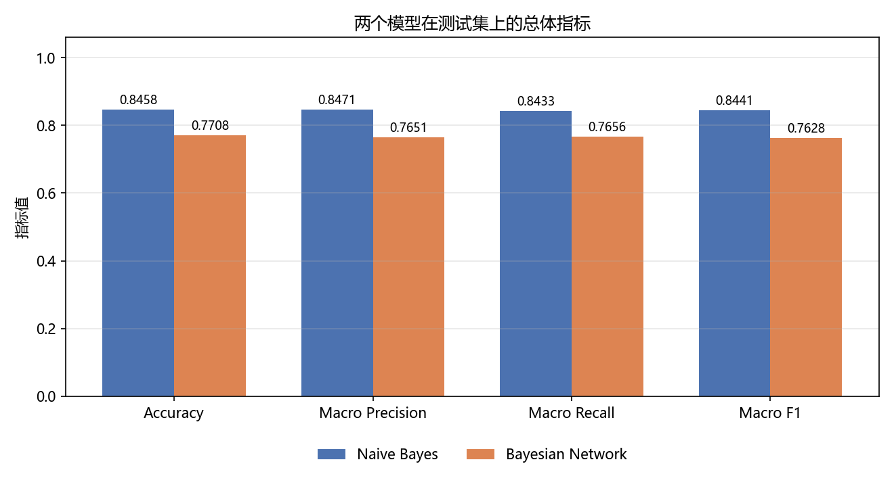
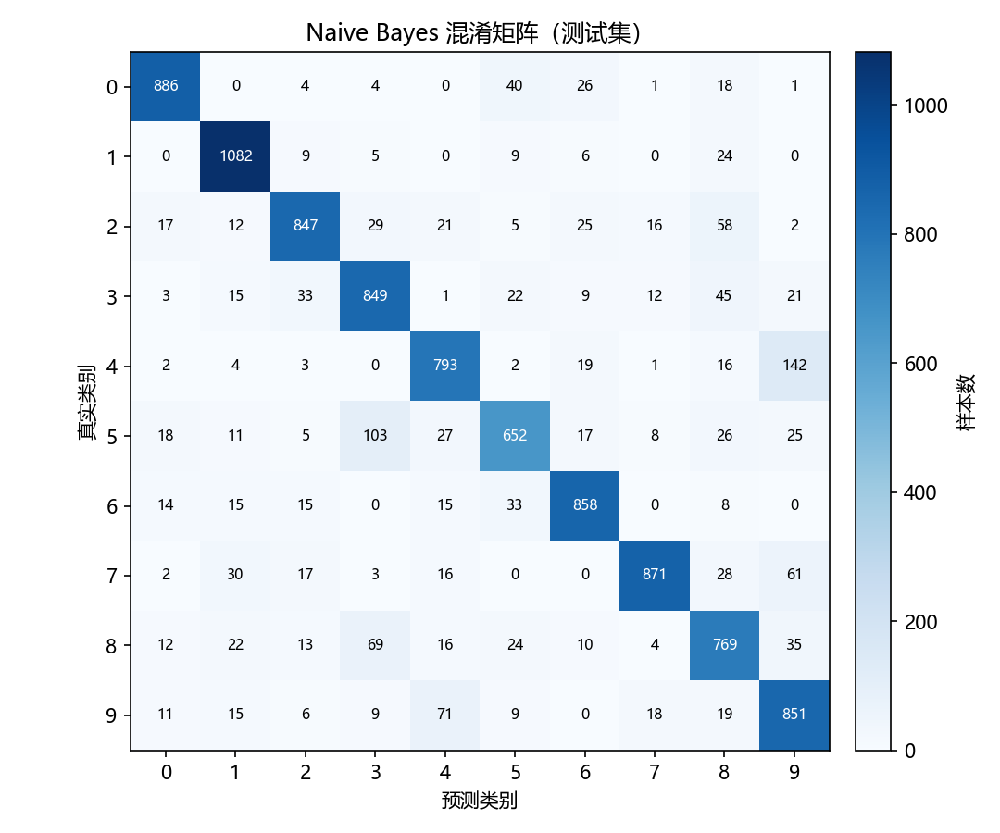
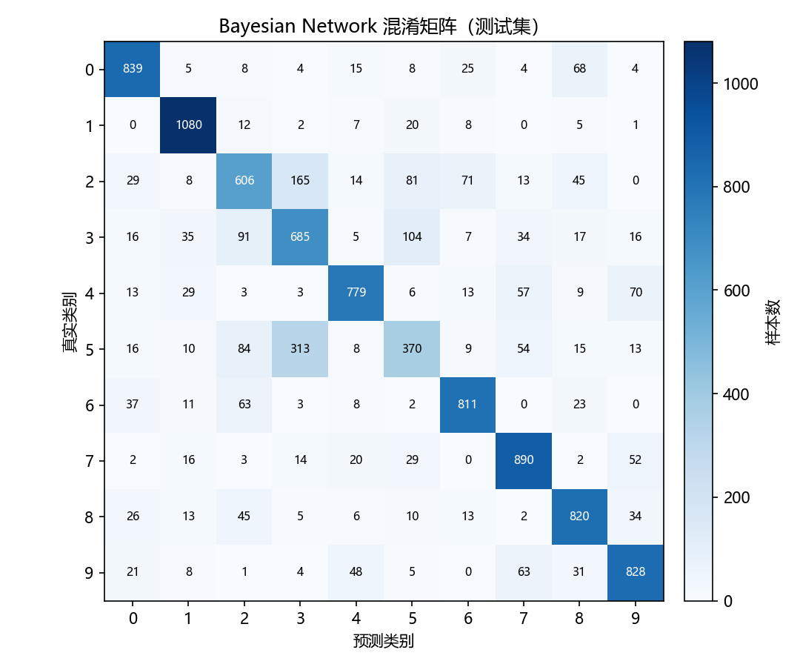
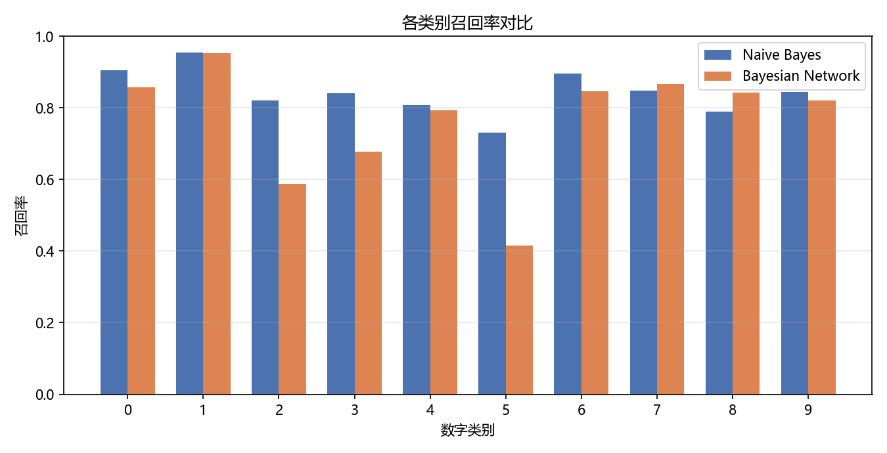
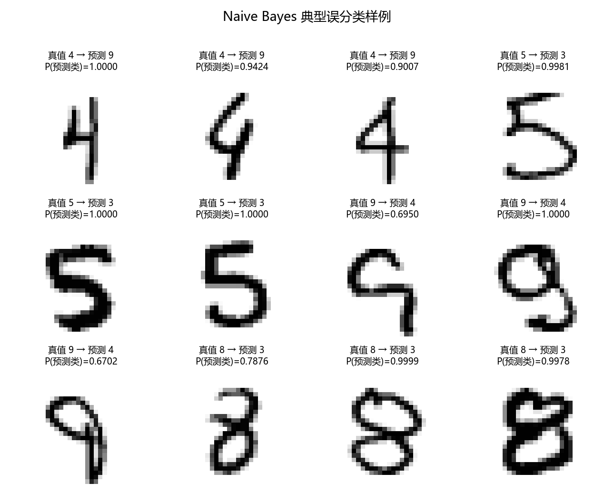
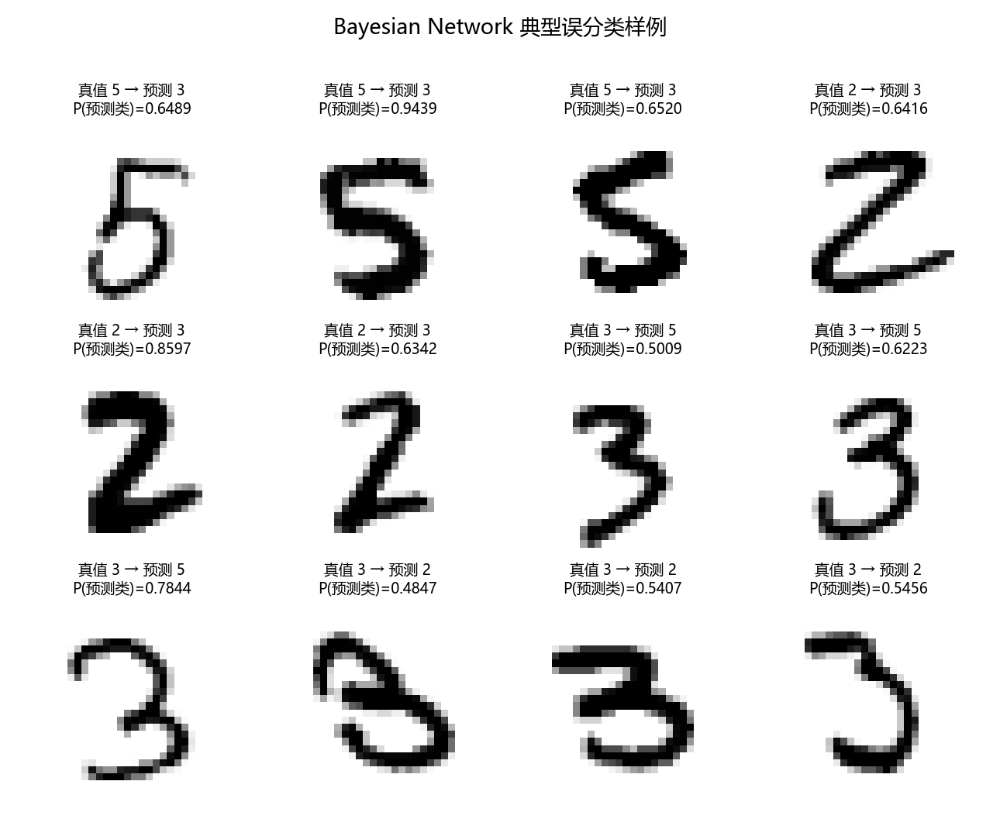

# Assignment 2：手写数字识别 —— 朴素贝叶斯与小型贝叶斯网络

| 项目 | 内容 |
|---|---|
| 课程 | BME1322 人工智能 |
| 姓名 / 学号 | 余沛壕 / 2023531053 |
| GitHub | yph888 |
| 提交目录 | `assignment2/` |
| 数据 | 课程提供 MNIST：60,000 张训练图、10,000 张测试图，28×28 灰度，像素 0–255 |

---

## 摘要

本作业从原始像素出发，独立实现了两个概率分类器，并在完整 MNIST 测试集上完成 10 类评估：

1. **朴素贝叶斯（Naive Bayes）**：把每个像素离散为 3 个灰度档，用类别条件独立的 categorical 似然建模，在 log 空间做 MAP 决策。测试集 **Accuracy = 0.8458，Macro-F1 = 0.8441**。
2. **小型手工贝叶斯网络（Bayesian Network）**：从图像中提取 12 个具有明确语义的离散特征（区域墨迹密度、笔迹起止行、孔洞数、中央扫描线笔画数、左右/上下对称度），手工设计含 5 条特征间有向边的 DAG，用极大似然 + Laplace 平滑学习全部 CPT，用对数联合概率做精确推理。测试集 **Accuracy = 0.7708，Macro-F1 = 0.7628**。

两个模型的核心概率建模、参数估计、平滑与预测逻辑均自行实现，只依赖 NumPy，没有调用 `sklearn.naive_bayes`、`pgmpy`、`bnlearn` 等现成实现。实验同时给出了混淆矩阵、每类指标、易混淆数字对与误分类样例，并从条件独立假设、特征粒度、证据重复计数等角度解释了二者的差异。

---

## 1. 总体设计

### 1.1 数据读取与预处理流程

数据通过课程提供的 `mnist_loader.py` 读取 IDX 文件，得到

```text
X_train: (60000, 28, 28) uint8    y_train: (60000,)
X_test : (10000, 28, 28) uint8    y_test : (10000,)
```

统一评测协议要求模型接收展平后的 `(n_samples, 784)` 矩阵，因此在 `main.py` 中先 `reshape(n, 784)` 再送入两个模型；两个模型内部都会再做一次输入校验，并兼容 `(n, 28, 28)` 的输入。

整体流程：

```text
IDX.gz ──课程 loader──> (n,28,28) uint8 ──展平──> (n,784)
                                                    │
                    ┌───────────────────────────────┴──────────────────────────┐
                    ▼                                                          ▼
        Naive Bayes：像素 3 档离散化                              Bayesian Network：12 个离散特征
        P(y)∏P(x_j|y)，log 空间 argmax                            P(y)∏P(F_i|Pa(F_i))，log 联合 argmax
                    │                                                          │
                    └──────────────► 测试集评估：Acc / Macro-P / R / F1 / 混淆矩阵 ◄──┘
```

两个模型的输入约定一致：都是原始 0–255 像素，所有二值化、离散化、特征提取都在模型内部完成。**没有使用测试集标签做任何训练或调参**；超参数只在训练集内部划分的验证集上选择（见 §4.2），最终指标在完整测试集上报告一次。

### 1.2 代码结构与统一协议

```text
assignment2/
├── naive_bayes.py     # NaiveBayesClassifier（协议 v1）
├── bayes_net.py       # BayesNetClassifier + extract_features（协议 v1）
├── main.py            # 训练、评估、指标与全部图表
├── requirements.txt
├── figures/           # 报告用图
└── report.md          # 本报告
```

两个类均严格实现讲义要求的接口：

```python
class NaiveBayesClassifier:
    def __init__(self, alpha: float = 1.0): ...
    def fit(self, X, y): ...      # 返回 self
    def predict(self, X): ...     # (n,) 预测标签
    def predict_proba(self, X): ...   # 可选，返回 (n,10) 后验

class BayesNetClassifier:
    def __init__(self, alpha: float = 1.0): ...
    def fit(self, X, y): ...
    def predict(self, X): ...
    def predict_proba(self, X): ...

def extract_features(X): ...      # (n,784) -> (n,12) 离散特征
```

两个构造器都**严格保持** `__init__(self, alpha: float = 1.0)` 这一个参数，没有添加任何额外参数。报告中用于对比的 multinomial / Bernoulli / 4 档变体通过额外的类方法配置，不影响协议签名：

```python
NaiveBayesClassifier()                                   # 默认 3 档 categorical
NaiveBayesClassifier.with_variant(alpha=1.0, variant="bernoulli")   # 仅用于对比实验
```

### 1.3 两个模型的建模粒度

| | Naive Bayes | Bayesian Network |
|---|---|---|
| 随机变量 | 784 个像素（每个 3 档） | 12 个语义特征（每个 3–5 档） |
| 图结构 | 只有 $Y\to x_j$，像素间无条件独立 | $Y\to$ 全部特征，另有 5 条特征间边 |
| 参数个数 | $10\times784\times3+10=23{,}530$ | $1{,}450+10=1{,}460$ |
| 训练时间（60k） | ≈1.3 s | ≈35 s（瓶颈是连通域特征提取） |
| 预测时间（10k） | ≈1.0 s | ≈5.8 s |

### 1.4 关键超参数

| 超参数 | 取值 | 说明 |
|---|---|---|
| 平滑系数 $\alpha$ | 1.0（两个模型相同） | Laplace 平滑；验证集上 0.1–2.0 差异 < 0.2 个百分点，取协议默认 1.0 |
| NB 灰度档数 | 3 | 验证集比较 3/4 档（§4.2） |
| NB 似然类型 | categorical | 与 multinomial、Bernoulli 比较后选择 |
| BN 特征数 | 12 | 讲义要求 6–12 |
| BN 每特征取值数 | 3–5 | 讲义要求 2–5 |
| BN 特征间边数 | 5 | 讲义要求 ≥2，且每个特征父节点数 ≤2 |

---

## 2. Naive Bayes 算法说明

### 2.1 贝叶斯公式如何用于分类

对图像 $X=(x_1,\dots,x_{784})$ 和类别 $y\in\{0,\dots,9\}$，贝叶斯公式给出

$$
P(y\mid X)=\frac{P(y)\,P(X\mid y)}{P(X)} .
$$

分母 $P(X)$ 与 $y$ 无关，因此分类只需比较分子：

$$
\hat y=\arg\max_y\; P(y)\,P(X\mid y).
$$

朴素贝叶斯的关键近似是**在给定类别时像素条件独立**：

$$
P(X\mid y)=\prod_{j=1}^{784}P(x_j\mid y),
\qquad
\hat y=\arg\max_y\; P(y)\prod_{j=1}^{784}P(x_j\mid y).
$$

直观上，它把“整张图属于某类的可能性”拆成“每个像素在该类下的灰度分布”之积：某个类若在笔画经过的位置习惯取高灰度、在背景位置习惯取低灰度，那么与该模式吻合的图像就会得到高分。

### 2.2 条件独立假设的含义与代价

条件独立**不是说像素之间独立**（相邻像素显然高度相关），而是说：**一旦知道了数字类别，第 $j$ 个像素的取值就不再提供关于第 $k$ 个像素的额外信息**。在这个假设下，联合似然可以写成 784 个一维分布的乘积，参数量从指数级降到线性级。

代价是：同一笔画的几十个像素会被当作几十份独立证据重复计数。例如一条竖线会同时提高其左右两侧像素的似然，模型会把“证据”放大很多倍，因此 NB 的后验概率往往过度自信（见 §4.7 的校准统计）。

### 2.3 像素离散化与似然

原始像素是 0–255 的灰度。若直接假设高斯分布并不合适（像素分布强烈偏斜、大量取 0），因此本实现把每个像素离散为 3 个灰度档：

$$
x_j =
\begin{cases}
0, & 0\le p_j\le 85,\\
1, & 86\le p_j\le 170,\\
2, & 171\le p_j\le 255.
\end{cases}
$$

每个像素因此是一个 categorical 变量，条件概率表为

$$
\theta_{c,j,v}=P(x_j=v\mid y=c),\qquad v\in\{0,1,2\}.
$$

选择 3 档而不是二值化的原因：中间灰度保留了抗锯齿/笔画边缘的厚度信息；验证集上 3 档（0.8565）略优于 4 档（0.8539）和二值化 multinomial（0.8447），因为档数越多每个 CPT 单元越稀疏，平滑带来的偏差越大。

### 2.4 对数概率的计算

784 个概率连乘会下溢（每个因子可能小到 $10^{-3}$，乘积远小于双精度下限），因此全程在对数空间计算：

$$
\log P(y\mid X)
= \log P(y)+\sum_{j=1}^{784}\log P(x_j\mid y)-\log P(X).
$$

最后一项对所有类别相同，预测时省略：

$$
\hat y=\arg\max_y\left[\log P(y)+\sum_{j=1}^{784}\log \theta_{y,j,x_j}\right].
$$

实现上，`predict_log_proba` 先算未归一化的对数后验，再用 log-sum-exp 归一化；`predict` 直接取 argmax。用矩阵/花式索引一次取出 $n\times784$ 个 $\log\theta$ 再按行求和，10 类的预测在 1 秒内完成。

### 2.5 平滑策略

若某个类别下某个像素从未取过某个灰度档，$\theta=0$，取对数后为 $-\infty$，一条样本就会被“一票否决”。因此对每个 CPT 做加 $\alpha$ 平滑（$\alpha=1$ 即 Laplace 平滑）：

$$
\hat\theta_{c,j,v}
=\frac{N_{c,j,v}+\alpha}{N_c+3\alpha},
\qquad
N_c=\sum_{j,v}N_{c,j,v}.
$$

分子加 $\alpha$ 保证每个格子非零，分母加 $3\alpha$ 保证每行仍归一化。$\alpha$ 越大，分布越接近均匀、先验越强；$\alpha$ 越小，越接近最大似然。本作业取 $\alpha=1$，并在验证集上检查了 $\alpha\in\{0.01,0.1,0.5,1,2\}$，准确率变化不超过 0.15 个百分点（§4.2）。

类别先验同样平滑：

$$
P(y=c)=\frac{N_c+\alpha}{N+10\alpha}.
$$

### 2.6 训练与预测复杂度

- 训练：一遍扫描统计 $N_{c,j,v}$，$O(n\cdot784)$，60k 样本约 1 秒。
- 预测：每个样本 $784\times10$ 次查表加法，$O(784\cdot10)$。
- 存储：$10\times784\times3$ 个浮点 CPT，约 0.2 MB。

---

## 3. 贝叶斯网络说明

### 3.1 特征选择：选了什么、为什么

贝叶斯网络不再把 784 个像素当作 784 个独立变量，而是先提取 12 个**有明确语义、取值少**的离散特征。选择原则有三条：

1. **覆盖数字形状的不同侧面**：墨迹在空间上的分布（区域密度）、笔迹的几何范围（起止行）、拓扑结构（孔洞）、笔画被扫描线切割的次数、对称性。
2. **彼此尽量互补**：密度描述“哪里有墨”，孔洞描述“哪里围出了空白”，笔画数描述“笔画如何穿过中线”，对称性描述全局布局。
3. **可解释、可复现**：每个特征都能用一句话说清，阈值是固定常数，不依赖标签。

| # | 特征（代码名） | 语义 | 计算方式（28×28，像素先除以 255） | 取值数 |
|---|---|---|---|---|
| 1 | `top_density` 顶部密度 | 图像上部墨迹多少 | 第 0–8 行像素均值 | 5 |
| 2 | `bottom_density` 底部密度 | 图像下部墨迹多少 | 第 19–27 行像素均值 | 5 |
| 3 | `left_density` 左侧密度 | 图像左部墨迹多少 | 第 0–8 列像素均值 | 5 |
| 4 | `right_density` 右侧密度 | 图像右部墨迹多少 | 第 19–27 列像素均值 | 5 |
| 5 | `top_row` 顶部行位置 | 笔迹最高点所在行 | 首个含墨迹（>127）的行号 | 5 |
| 6 | `bottom_row` 底部行位置 | 笔迹最低点所在行 | 最后一个含墨迹的行号 | 5 |
| 7 | `center_density` 中心密度 | 中央 12×12 区域的墨量 | 第 8–19 行、第 8–19 列均值 | 5 |
| 8 | `holes` 孔洞数 | 被笔画包围的背景区域数 | 欧拉数 $E=C-H$ 与连通域数 $C$ 得 $H=C-E$ | 5 |
| 9 | `mid_col_strokes` 中列笔画数 | 中央竖线穿过几段笔画 | 第 13 列上连续墨迹段数 | 4 |
| 10 | `mid_row_strokes` 中行笔画数 | 中央横线穿过几段笔画 | 第 13 行上连续墨迹段数 | 3 |
| 11 | `lr_symmetry` 左右对称度 | 左右镜像的重合程度 | $\sum\min(I,I^{\text{lr}})/\sum\max(I,I^{\text{lr}})$ | 5 |
| 12 | `tb_symmetry` 上下对称度 | 上下镜像的重合程度 | $\sum\min(I,I^{\text{tb}})/\sum\max(I,I^{\text{tb}})$ | 5 |

几个设计细节：

- **孔洞数**是区分 0/6/9（1 个洞）与 8（2 个洞）和 1/2/3/4/5/7（通常 0 个洞）的关键拓扑特征。实现上先用 8 邻域 DFS 数连通域 $C$，再用 2×2 方块公式数欧拉数 $E=C-H$，二者相减得到孔洞数 $H$。这样只需一次连通域标记，不需要对背景再做一次填充，纯 NumPy 即可完成（环境无 SciPy）。
- **中列/中行笔画数**刻画“笔画如何穿过中线”。例如 0 的中列通常穿过 2 段（上下两条边），8 可能穿过 3 段，1 只有 1 段。它比单纯的密度更能表达“结构”。
- **对称度**用灰色值而非二值计算，既奖励位置重合，也奖励笔画粗细一致。
- **连通域数本身几乎不携带类别信息**：在 60k 训练集中约 97% 的数字只有一个 8 连通域，因此没有把它单独作为特征；但它作为孔洞数的中间量被保留在实现中。



*图 1：一个测试样本（数字 3）的特征计算示例。左：原图；中左：水平三区（顶部/中部/底部）；中右：垂直三区与中央扫描线；右：12 个特征的原始值与离散等级。*

### 3.2 离散化方式

连续特征用训练集上的 20/40/60/80 分位数切成 5 档；计数类特征用整数切点：

- `holes`：$[0.5,1.5,2.5,3.5]$ → 0,1,2,3,≥4；
- `mid_col_strokes`：$[1.5,2.5,3.5]$ → 1,2,3,≥4；
- `mid_row_strokes`：$[1.5,2.5]$ → 1,2,≥3；
- `top_row` / `bottom_row`：行号中点切分（如 3.5/4.5/5.5/6.5）。

阈值在 60,000 张训练图上一次性标定后写成 `bayes_net.py` 中的常量 `_THRESHOLDS`。这样做有两个好处：

1. `extract_features(X)` 是**无状态的纯函数**，符合协议“可复用”的要求，评测程序可以单独调用它；
2. 阈值只依赖像素分布、不依赖标签，不存在标签泄漏。

完整阈值见附录 B。

### 3.3 DAG 结构图



*图 2：手工设计的小型贝叶斯网络。深灰节点为类别根节点 $Y$；浅灰边表示 $Y\to$ 每个特征；彩色边为 5 条特征间依赖（橙色来自孔洞数，蓝色来自顶部密度，绿色来自右侧密度）。*

形式化地，网络包含 13 个节点（$Y$ + 12 个特征），边集为

$$
\{Y\to F_i\}_{i=1}^{12}
\;\cup\;
\{\text{holes}\to\text{mid\_col\_strokes},\;
\text{holes}\to\text{mid\_row\_strokes},\;
\text{holes}\to\text{center\_density},\;
\text{top\_density}\to\text{tb\_symmetry},\;
\text{right\_density}\to\text{lr\_symmetry}\}.
$$

每个特征节点的父节点数不超过 2（$Y$ + 至多 1 个特征），$Y$ 是唯一的根，没有隐藏变量，也没有使用任何自动结构学习算法。

### 3.4 每条边的语义解释

| 边 | 语义解释 |
|---|---|
| $Y\to$ 全部 12 个特征 | 数字类别决定了笔画的整体布局：例如 1 的左右密度都低、8 的孔洞数为 2、0 的中心密度低。这是分类信息的来源。 |
| `holes` → `mid_col_strokes` | 中央竖线穿过一个闭合环时，必然“进入再离开”该环，至少多出 2 段墨迹。孔洞越多，中列被切割出的笔画段数倾向越多。 |
| `holes` → `mid_row_strokes` | 同上，只是沿中央横线扫描。一个环在水平方向也会造成多次进出。 |
| `holes` → `center_density` | 孔洞意味着中央附近存在成片背景：0/6/9 的中心往往较空，而 8 虽然有两个洞，笔画仍穿过中心。已知孔洞数后，中心密度的条件分布会明显不同。 |
| `top_density` → `tb_symmetry` | 上下对称度由上下两半的重合度决定；顶部墨量很少时，无论下半部如何，重合度都不可能高。顶部密度因此约束了对称度的取值范围。 |
| `right_density` → `lr_symmetry` | 同理，右侧墨量很少时，左右镜像几乎不可能重合，右侧密度约束了左右对称度的分布。 |

需要强调：这里的边表达的是**在给定类别后仍存在的直接概率依赖**，不一定是物理因果。例如孔洞数与笔画数都由笔迹形状决定，但把“孔洞数 → 笔画数”作为有向边，可以在给定 $Y$ 后把二者的相关性从 CPT 中显式建模出来，而不必假设它们条件独立。

### 3.5 CPT 学习方式

对每个特征 $F_i$，设其父节点集合为 $\mathrm{Pa}(F_i)$（一定包含 $Y$，可能再包含 1 个特征）。CPT 用训练数据中的计数做极大似然估计，并加 $\alpha$ 平滑：

$$
\hat P\big(F_i=v\mid \mathrm{Pa}(F_i)=p\big)
=\frac{N(v,p)+\alpha}{N(p)+\alpha\,K_i},
$$

其中 $N(v,p)$ 是“父节点取配置 $p$ 且 $F_i=v$”的训练样本数，$N(p)=\sum_v N(v,p)$，$K_i$ 是该特征的取值数，$\alpha=1$。

实现上把 $(y,\text{父配置},f_i)$ 编码成一个平坦整数下标，用 `np.bincount` 一次统计所有格子，再 reshape 成 $(10,\prod K_{\text{pa}},K_i)$ 的张量并取对数。全部 12 张 CPT 合计 1,450 个概率单元，60k 样本下每格平均约 40 个样本，平滑主要起“防止零概率”和“轻微向均匀分布收缩”的作用。

### 3.6 预测：对数联合概率

预测时所有特征都被观测，不需要变量消元或采样，直接算对数联合概率：

$$
\log P(y,F_1,\dots,F_{12})
=\log P(y)+\sum_{i=1}^{12}\log \hat P\big(F_i\mid \mathrm{Pa}(F_i)\big),
$$

$$
\hat y=\arg\max_y \log P(y,F_1,\dots,F_{12}).
$$

由于 $P(F_1,\dots,F_{12})$ 与 $y$ 无关，这等价于精确后验 $\arg\max_y P(y\mid F)$。数值上同样在对数空间相加，避免 12 个概率连乘下溢。

### 3.7 与 Naive Bayes 的关系和差异

- **包含关系**：若把 BN 中 5 条特征间边全部删掉，并令每个特征只有父节点 $Y$，则

  $$
  P(y,F)=P(y)\prod_i P(F_i\mid y),
  $$

  这正是特征层面的朴素贝叶斯。因此本作业的 BN 可以看作“在 12 个聚合特征上、放松了条件独立假设”的 NB。消融实验（§4.2）显示，加入 5 条边后验证集准确率从 0.7832 提升到 0.7904，说明这些依赖确实存在且被 CPT 捕捉到了一部分。
- **建模粒度不同**：NB 的 784 个像素提供了远多于 12 个特征的判别信息，所以 NB 的准确率更高；BN 的每个特征都经过聚合，丢失了笔画的具体位置与形状细节，但换来了更小的参数量、更好的可解释性和更温和的概率输出。
- **独立性假设的强弱**：NB 假设 784 个像素在类别给定后全部独立，这个假设明显不成立；BN 只假设“在给定父节点后”每个特征与其余特征独立，条件集更大，假设更弱。
- **概率校准**：NB 因重复计数证据而严重过度自信（测试集上 92.1% 的预测最大后验 > 0.99）；BN 的特征少、依赖性被部分建模，平均最大后验为 0.854，过度自信程度明显更低。

---

## 4. 实验评估

### 4.1 实验设置

- 训练：完整 60,000 张训练图；测试：完整 10,000 张测试图。
- 指标：Accuracy、Macro Precision、Macro Recall、Macro F1、混淆矩阵、每类 P/R/F1。
- 超参数选择：在训练集内部取前 50,000 张训练、后 10,000 张验证（**不碰测试集**），仅用于选择 NB 的似然类型/档数/$\alpha$ 和 BN 的结构消融；选定后用全部 60,000 张重训，再在测试集上评估一次。
- 运行环境：Python 3.10，NumPy 1.23，Matplotlib 3.10；纯 CPU。

> 说明：验证集（训练集最后 10k）比测试集略“容易”。例如同一个 50k 训练的 NB，在验证集上 0.8565、在测试集上 0.8473。因此验证集数字只用于相对比较，最终结论以测试集为准。

### 4.2 模型选择实验（验证集）

**Naive Bayes 的似然与离散化**（50k 训练 / 10k 验证）：

| 变体 | 验证 Accuracy |
|---|---:|
| Categorical，3 档（**采用**） | **0.8565** |
| Categorical，4 档 | 0.8539 |
| Multinomial（二值化，像素 >128） | 0.8447 |
| Bernoulli（显式建模像素缺席） | 0.8539 |

Categorical 3 档最好。Bernoulli 与它接近，但 Bernoulli 需要对 784 个像素都计入“缺席”项，背景像素的 $1-p$ 项会淹没笔画信号；multinomial 则忽略了“某个像素没有出现”也是信息。

**平滑系数 $\alpha$**（Categorical 3 档）：

| $\alpha$ | 0.01 | 0.1 | 0.5 | 1.0（采用） | 2.0 |
|---|---:|---:|---:|---:|---:|
| 验证 Accuracy | 0.8575 | 0.8578 | 0.8568 | 0.8565 | 0.8563 |

$\alpha$ 在 0.01–2 之间变化不到 0.15 个百分点，说明 60k 样本下 CPT 已足够稠密；按协议默认取 $\alpha=1$（Laplace）。

**贝叶斯网络的结构消融**（同样的 50k/10k 划分，固定 12 个特征）：

| 结构 | 验证 Accuracy |
|---|---:|
| 只有 $Y\to F_i$（等价于特征级 NB） | 0.7832 |
| 完整结构（+5 条特征间边，**采用**） | **0.7904** |

5 条边带来约 +0.7 个百分点，说明孔洞数→笔画数、密度→对称度这些依赖确实存在；但提升有限，也说明 12 个聚合特征已经比较接近条件独立。

### 4.3 测试集总体指标

| 模型 | Accuracy | Macro Precision | Macro Recall | Macro F1 |
|---|---:|---:|---:|---:|
| Naive Bayes | **0.8458** | **0.8471** | **0.8433** | **0.8441** |
| Bayesian Network | 0.7708 | 0.7651 | 0.7656 | 0.7628 |



*图 3：两个模型在完整测试集（10,000 张）上的四项总体指标。*

### 4.4 混淆矩阵



*图 4：Naive Bayes 测试集混淆矩阵（行 = 真实类别，列 = 预测类别）。*



*图 5：Bayesian Network 测试集混淆矩阵。*

### 4.5 每类指标

**Naive Bayes**

| 类别 | Precision | Recall | F1 | Support |
|---:|---:|---:|---:|---:|
| 0 | 0.9181 | 0.9041 | 0.9111 | 980 |
| 1 | 0.8972 | 0.9533 | 0.9244 | 1135 |
| 2 | 0.8897 | 0.8207 | 0.8538 | 1032 |
| 3 | 0.7927 | 0.8406 | 0.8160 | 1010 |
| 4 | 0.8260 | 0.8075 | 0.8167 | 982 |
| 5 | 0.8191 | 0.7309 | 0.7725 | 892 |
| 6 | 0.8845 | 0.8956 | 0.8900 | 958 |
| 7 | 0.9356 | 0.8473 | 0.8892 | 1028 |
| 8 | 0.7606 | 0.7895 | 0.7748 | 974 |
| 9 | 0.7478 | 0.8434 | 0.7927 | 1009 |

**Bayesian Network**

| 类别 | Precision | Recall | F1 | Support |
|---:|---:|---:|---:|---:|
| 0 | 0.8398 | 0.8561 | 0.8479 | 980 |
| 1 | 0.8889 | 0.9515 | 0.9191 | 1135 |
| 2 | 0.6616 | 0.5872 | 0.6222 | 1032 |
| 3 | 0.5718 | 0.6782 | 0.6205 | 1010 |
| 4 | 0.8560 | 0.7933 | 0.8235 | 982 |
| 5 | 0.5827 | 0.4148 | 0.4846 | 892 |
| 6 | 0.8474 | 0.8466 | 0.8470 | 958 |
| 7 | 0.7968 | 0.8658 | 0.8298 | 1028 |
| 8 | 0.7923 | 0.8419 | 0.8163 | 974 |
| 9 | 0.8134 | 0.8206 | 0.8170 | 1009 |



*图 6：两个模型在 10 个类别上的召回率对比。*

### 4.6 最易混淆的数字对与误分类样例

**最易混淆对（测试集，按错误数排序）**

| Naive Bayes | 次数 | Bayesian Network | 次数 |
|---|---:|---|---:|
| 4 → 9 | 142 | 5 → 3 | 313 |
| 5 → 3 | 103 | 2 → 3 | 165 |
| 9 → 4 | 71 | 3 → 5 | 104 |
| 8 → 3 | 69 | 3 → 2 | 91 |
| 7 → 9 | 61 | 5 → 2 | 84 |



*图 7：Naive Bayes 的 12 个典型误分类样例（从最常见的 4 组混淆对中各取 3 例）。*



*图 8：Bayesian Network 的 12 个典型误分类样例。*

> 说明：NB 的 $P(\text{预测类})$ 大量为 1.0000，不是作图错误，而是 784 个条件独立似然连乘造成的过度自信（见 §4.7）。

**误分类原因分析**

1. **4 ↔ 9（NB 共 213 例）**：4 和 9 共享“竖笔 + 斜笔 + 上部封闭/半封闭区域”的结构。手写 4 的上部一旦闭合，像素级 NB 会把它读成 9 的“洞 + 右侧竖笔”；反之，开口的 9 又像 4。图 7 第一行三个 4 的上部都有明显的闭合趋势：第一个被以 $P=1.0000$ 判成 9，后两个的预测概率也高达 0.94 和 0.90 —— 这既是形状歧义，也是 NB 过度自信的体现。
2. **5 → 3（NB 103 例，BN 313 例）**：5 的“上横 + 下弧”和 3 的“上弧 + 下弧”在粗粒度特征上非常接近。BN 只有 12 个区域/结构特征，无法分辨“顶部是直横还是弯弧”“左侧是否开口”，于是把大量 5 判成 3（892 个 5 中有 313 个）。这是 BN 在 5 类上召回率只有 0.4148 的直接原因。
3. **2 ↔ 3（BN 165 + 91 例）**：2 和 3 都有上弧与下横，区别主要在右中部的笔画走向；区域密度与对称度对这条细笔画不敏感。
4. **8 → 3（NB 69 例）**：8 的两个环若墨迹较淡、下半环开口，容易被读成 3；NB 的像素似然更关注“哪些位置有墨”，对“环是否闭合”这种全局拓扑不敏感。BN 有孔洞数特征，8 的召回率反而更高（0.8419 vs 0.7895）。
5. **7 → 9（NB 61 例）**：带钩的 7 与 9 的右上部分相似；NB 对竖笔倾斜角度不敏感。

从图 7/图 8 也可以看到，部分“错误”样本本身处于人类也会犹豫的边界（例如顶部开口的 4、写得像 3 的 5），这提示 MNIST 中存在少量标注歧义样本，任何模型都难以完全避免。

### 4.7 两个模型的对比分析

| 维度 | Naive Bayes | Bayesian Network |
|---|---|---|
| 测试 Accuracy | **0.8458** | 0.7708 |
| 参数量 | 23,530 | 1,460 |
| 训练/预测耗时 | 1.3 s / 1.0 s | 35 s / 5.8 s |
| 输入粒度 | 784 个像素 | 12 个聚合特征 |
| 概率校准（平均最大后验） | 0.9879 | 0.8541 |
| 最大后验 > 0.99 的样本占比 | 92.09% | 32.78% |
| 优势类别（Recall） | 3、5、9 明显更好 | 7、8 略好 |

**为什么 NB 更准？** NB 使用了全部 784 个像素，保留了笔画的位置、粗细、倾斜等细节；BN 把图像压缩成 12 个标量，信息损失很大。对 MNIST 这种类间差异主要体现在局部笔画形状的任务，像素级模型的优势是决定性的。

**为什么 BN 仍有价值？** 它的参数量只有 NB 的 6%，可解释性强（每条边、每个 CPT 都能读出含义），概率输出更接近真实置信度，而且在 7、8 上反而更好——孔洞数、笔画数这些拓扑特征补足了像素模型不擅长的全局结构。

**为什么 NB 这么自信？** 条件独立假设让同一笔画的几十个像素各自贡献一份似然，证据被重复计算几十次，log 后验的类间差距被放大，softmax 后大量样本接近 1.0。这是 NB 的经典缺陷，不是实现错误。若需要可靠的概率，可以做温度缩放/Platt 校准，或使用混合模型。

**共同弱点**：两个模型都在 3/5/8 上表现较差，说明仅靠“区域墨迹 + 简单拓扑”或“像素独立”都不足以稳定区分这些形状相近、书写变体大的数字。

---

## 5. 讨论与反思

### 5.1 遇到的困难

1. **纯 NumPy 实现连通域与孔洞**：环境没有 SciPy/OpenCV。最初想用迭代标签传播，但在 60k×28×28 上太慢；最终用“8 邻域 DFS 数连通域 + 2×2 方块公式数欧拉数”的组合，一次遍历即可得到 $C$ 与 $E$，再由 $H=C-E$ 得孔洞数。实现时还验证了欧拉公式的连通性约定（8 连通前景对应 $-2n_D$ 项），并用暴力 BFS 在 200 张图上逐个比对，确认 100% 一致后才使用。
2. **特征冗余**：最初按讲义示例选了“上/中/下 + 左/中/右”六个密度，验证集只有 0.70 左右；逐步替换发现左侧密度与右侧密度高度相关，保留两者反而稀释了 CPT 的估计。最终用“顶部行位置/底部行位置/中心密度/笔画数”替换了信息量低的特征，验证集提升到 0.79。这说明**特征不是越多越好，条件独立假设下冗余特征会重复计权**。
3. **离散化阈值**：分位数切分在稀疏特征（孔洞数、笔画数）上会产生空档，必须改用自然整数切点；而连续特征用分位数可以保证每档样本量均衡。两类特征要区别对待。
4. **验证集与测试集的分布差异**：训练集最后 10k 比测试集容易约 1 个百分点，一开始误以为是代码 bug，后来用同一模型分别在验证集/测试集评估才确认是数据划分差异。这也提醒我：调参必须留出独立验证集，最终结论只能看测试集。
5. **概率饱和**：NB 输出大量 1.0000，导致“置信度”失去区分度，误分类图一开始全按置信度排序，选出的都是极端样本；后来改为按“最常见混淆对”分层取样，才让错误分析更有代表性。

### 5.2 朴素贝叶斯的局限性

- **条件独立假设明显不成立**：相邻像素、同一笔画的像素高度相关，模型把一份证据重复计数，导致后验过度自信、对数似然被少数关键像素主导。
- **对平移/倾斜/粗细敏感**：像素位置是固定的，数字稍微平移或倾斜，似然就会大幅变化；MNIST 已做中心化，但真实场景不会。
- **只能表达“哪里有墨”，不能表达“结构”**：无法直接表达“这个环是否闭合”“这条线是否连续”，只能靠像素组合间接体现。
- **离散化损失信息**：3 档灰度把笔画边缘的细粒度信息抹平；档数增加又会带来 CPT 稀疏与平滑偏差。

### 5.3 贝叶斯网络结构设计的挑战

- **特征粒度与判别力的权衡**：特征越抽象越可解释、参数越少，但判别力越弱；12 个特征已是讲义上限，仍不足以区分 5/3。
- **边的方向与语义**：BN 的边应表达条件依赖，但很多特征之间是“共同由笔迹决定”的相关关系，没有天然因果方向。选边时既要语义说得通，又要在验证集上不降点，二者有时冲突（例如 `top_row → bottom_row` 语义很强，但加上后验证集反而略降，最终没有采用）。
- **参数稀释**：每加一条边，子节点的 CPT 就多乘一个父节点取值数，在 60k 样本下每格样本变少，估计方差变大；这也是“加边不一定涨点”的原因。
- **无法使用自动结构学习**：讲义明确禁止自动结构学习，因此只能靠人工分析 + 小规模消融来选边，结构搜索空间无法系统覆盖。

### 5.4 如果继续改进

1. **NB 方向**：对像素做 2×2 池化或使用像素级 TAN（每个像素至多一个像素父节点），在保留细节的同时建模局部相关；或用混合朴素贝叶斯（每个类多个 component）缓解多峰分布；再做温度缩放校准概率。
2. **BN 方向**：增加更有判别力的局部特征（如 4×4 子区域密度、笔画方向直方图、上下/左右半区笔画数），在 12 个特征的限制下做更系统的特征选择；尝试层次化结构（低层密度 → 高层形状 → 类别）或引入极少量隐变量（如“笔画粗细”）——后者虽超出本次作业限制，但能显著提升表达力。
3. **融合**：用 NB 的像素级后验与 BN 的结构化后验做对数线性融合/ stacking，可能兼得精度与可解释性。
4. **评估**：增加交叉验证、置信区间与配对显著性检验，避免单次划分带来的波动；对易混淆类做定向数据增强或专门的特征。

---

## 附录 A：复现方式

```bash
# 依赖：Python >= 3.8, numpy, matplotlib
pip install -r requirements.txt

# 自动查找数据目录（常见位置：../assignment2-data/mnist 等）
python main.py

# 或显式指定数据目录（目录内需有 train-images-idx3-ubyte.gz 等四个文件）
python main.py --data /path/to/assignment2-data/mnist
```

`main.py` 会自动完成：加载数据 → 训练两个模型 → 在测试集上计算全部指标 → 写出 `results/results.json` → 生成 `figures/` 下的全部图片。常用参数：

```bash
python main.py --no-figures          # 只算指标，不画图
python main.py --alpha 0.5           # 修改平滑系数
python main.py --nb-variant bernoulli
```

单独使用两个模型：

```python
from naive_bayes import NaiveBayesClassifier
from bayes_net import BayesNetClassifier, extract_features

nb = NaiveBayesClassifier(alpha=1.0).fit(X_train, y_train)
pred = nb.predict(X_test)

bn = BayesNetClassifier(alpha=1.0).fit(X_train, y_train)
F = extract_features(X_test)          # (n, 12) 离散特征
pred = bn.predict(X_test)
```

## 附录 B：贝叶斯网络特征阈值

| 特征 | 切分阈值 | 档数 |
|---|---|---:|
| top_density | 0.0492, 0.0685, 0.0912, 0.1190 | 5 |
| bottom_density | 0.0632, 0.0847, 0.1102, 0.1439 | 5 |
| left_density | 0.0023, 0.0226, 0.0436, 0.0720 | 5 |
| right_density | 0.0123, 0.0398, 0.0649, 0.0994 | 5 |
| top_row | 3.5, 4.5, 5.5, 6.5 | 5 |
| bottom_row | 21.5, 22.5, 23.5, 24.5 | 5 |
| center_density | 0.2741, 0.3417, 0.4035, 0.4798 | 5 |
| holes | 0.5, 1.5, 2.5, 3.5 | 5 |
| mid_col_strokes | 1.5, 2.5, 3.5 | 4 |
| mid_row_strokes | 1.5, 2.5 | 3 |
| lr_symmetry | 0.1888, 0.2536, 0.3127, 0.3892 | 5 |
| tb_symmetry | 0.1569, 0.2097, 0.2661, 0.3484 | 5 |

## 附录 C：提交内容

```text
assignment2/
├── naive_bayes.py      # Naive Bayes 统一协议模型（NumPy 自实现）
├── bayes_net.py        # 小型贝叶斯网络统一协议模型 + extract_features
├── main.py             # 训练与评估入口（指标、混淆矩阵、图表）
├── requirements.txt    # numpy；matplotlib（仅绘图需要）
├── figures/            # 报告图片（结构图、混淆矩阵、误分类样例等）
└── report.md           # 本报告
```

MNIST 原始数据未提交进仓库。

## 附录 D：参考与学术诚信

**参考资料**

1. Y. LeCun, L. Bottou, Y. Bengio, P. Haffner. *Gradient-based learning applied to document recognition.* Proceedings of the IEEE, 1998.（MNIST 数据集）
2. C. M. Bishop. *Pattern Recognition and Machine Learning.* Springer, 2006.（第 2 章概率分布；第 8 章图模型）
3. K. P. Murphy. *Machine Learning: A Probabilistic Perspective.* MIT Press, 2012.（第 3 章贝叶斯分类器；第 10 章近似推断）
4. 课程讲义：第 5 章 概率推理与贝叶斯准则；第 6 章 贝叶斯网络。
5. MNIST 数据镜像与校验值见课程 `assignment2-data/README.md`。

**学术诚信声明**

- 两个模型的核心概率建模、参数估计、平滑、推理与特征提取均为独立实现，未复制任何现成的朴素贝叶斯/贝叶斯网络代码，也未调用 `sklearn.naive_bayes`、`pgmpy`、`bnlearn` 等库。
- 未使用自动结构学习；网络结构、特征与离散化方案均为手工设计，并通过训练集内部的验证集进行消融比较。
- 按课程要求使用了人工智能编程助手辅助实现与文字整理；所有代码、实验均由作者本人运行、核对，并对报告内容负责。
- 引用的教材与数据集已在上面列出；除此之外未使用其他外部代码片段。
