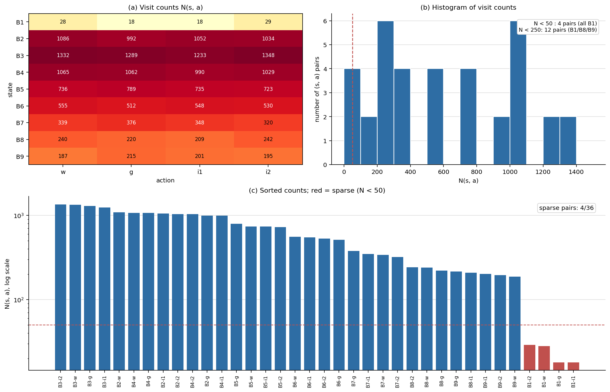
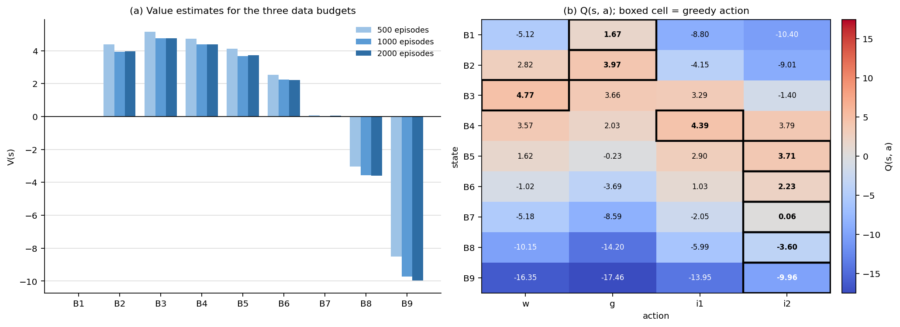
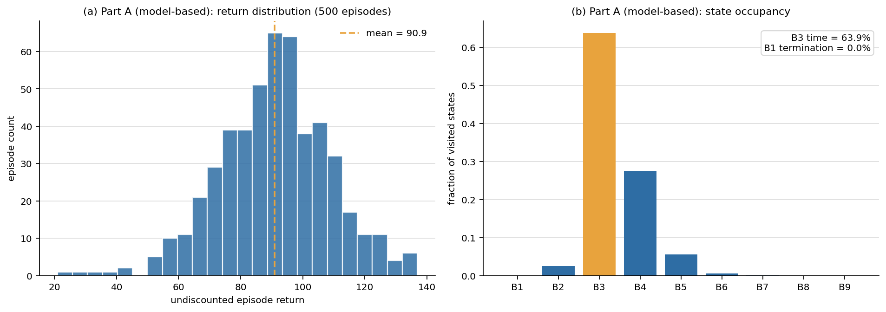
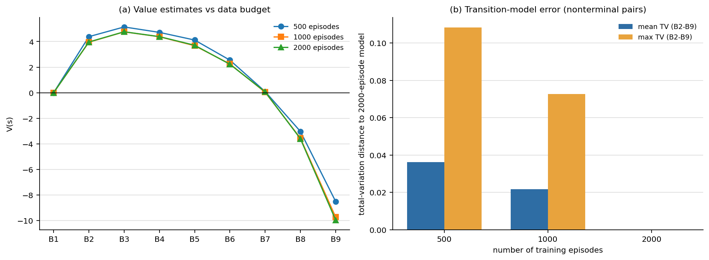
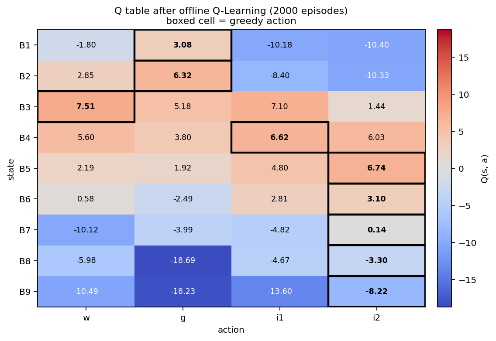
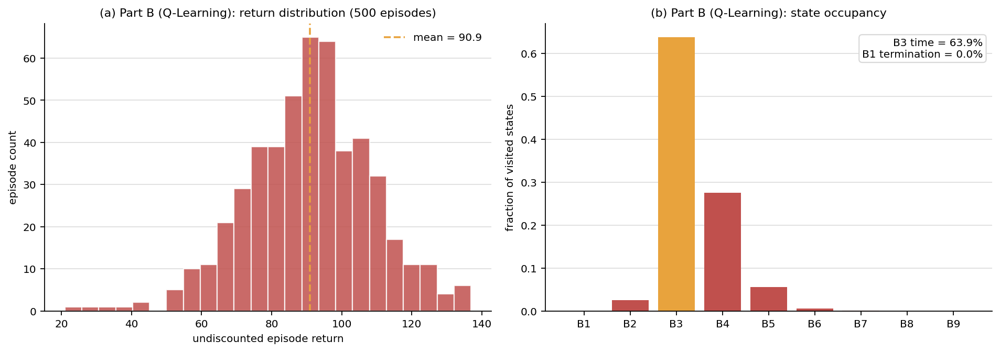
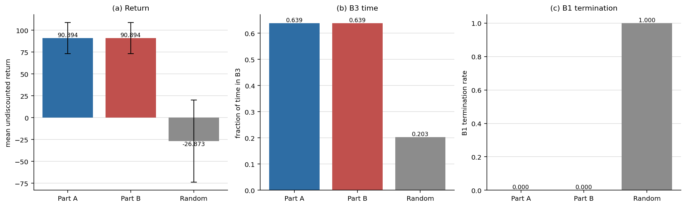
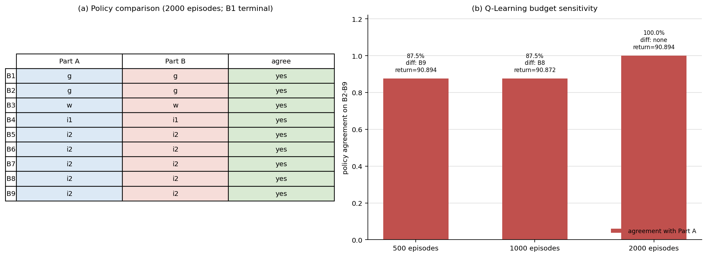
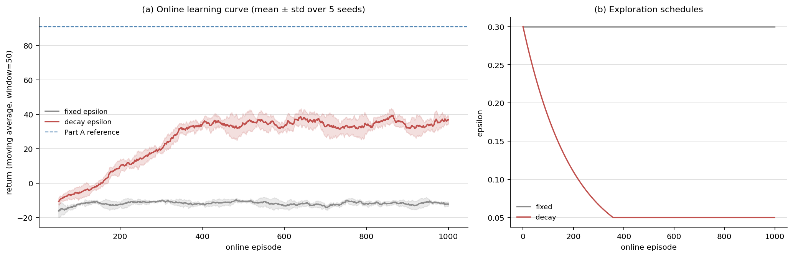
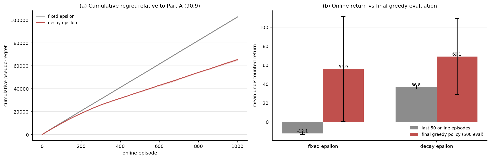

# Assignment 3：血糖调控智能体 —— 基于模型的学习与 Q-Learning

| 项目 | 内容 |
|---|---|
| 课程 | BME1322 人工智能 |
| 姓名 / 学号 | 余沛壕 / 2023531053 |
| GitHub | yph888 |
| 提交目录 | `assignment3/` |
| 运行环境 | Python 3.10、NumPy、Matplotlib（不使用任何 RL/规划库） |

## 摘要

本作业在课程提供的 9 状态血糖调控环境上比较两条无模型强化学习路线。Part A 采用“先学模型、再规划”：用计数法从 2000 条均匀随机 episode 中估计转移模型 $\hat P(s'\mid s,a)$ 与奖励模型 $\hat R(s,a)$，在估计模型上做同步价值迭代，再用贪心策略提取得到 $\pi(s)$。在 500 条独立评估轨迹上，Part A 策略取得 **90.894** 的平均无折扣回报、**63.85%** 的 B3 时间比例和 **0%** 的 B1 终止率。

Part B 使用同一份数据做离线表格 Q-Learning。2000 条数据上，Q-Learning 与 Part A 的贪心策略在 8 个非终止状态上**完全一致（8/8）**，500 条评估轨迹的三项指标也相同（90.894 / 63.85% / 0%）；但把数据预算降到 500/1000 条时，Q-Learning 分别在 B9/B8 上翻转（一致率 7/8），而模型法保持稳定。补充的在线实验（5 seeds × 1000 episodes）显示：固定 $\varepsilon=0.3$ 的最后 50 集平均回报为 **−12.11**、累计伪 regret 为 **102,744**；衰减 $\varepsilon$（0.3→0.05）则提高到 **36.79**、regret 降至 **65,451**。不过，在常数 $\alpha=0.5$ 与 $\varepsilon_{\min}=0.05$ 下，在线 Q-Learning 的最终贪心策略（55.87 / 69.11）仍未达到离线规划的 90.894，说明探索成本与学习率收敛条件仍然是安全关键任务的主要瓶颈。

---

## 1. 总体设计

### 1.1 两条路线的关系

课程环境是一个折扣因子 $\gamma=0.9$、每步 15 分钟、单条轨迹最多 $T=200$ 步的离散 MDP。状态为血糖区间 B1–B9，动作为 `w`（等待）、`g`（补糖）、`i1`（小剂量胰岛素）、`i2`（大剂量胰岛素）。奖励在进入下一状态时给出：$r=R(s')+c(a)$，其中 $R(s')$ 是状态奖励，$c(a)$ 是动作成本；进入 B1 立即终止。

两条路线的区别只在“如何得到价值”：

```text
Part A：episodes ──计数法──> P̂(s'|s,a), R̂(s,a) ──同步价值迭代──> V̂(s) ──贪心──> π_A(s)
Part B：episodes ──逐条 TD 更新──> Q(s,a) ──────────────────────────贪心──> π_B(s)
```

Part A 把样本首先压缩成模型，再由模型做全局规划；Part B 不显式建模环境，直接把样本用于 Q 值更新。两者使用完全相同的 2000 条 episode，因而可以公平比较样本效率与最终性能。

### 1.2 代码结构

```text
assignment3/
├── model_based.py     # Part A：ModelBasedAgent（计数模型 + 同步价值迭代）
├── q_learning.py      # Part B：QLearningAgent（表格 Q-Learning）
├── main.py            # 数据采集、训练、评估、消融、在线实验与全部图表
├── requirements.txt
├── analysis.md
├── figures/
└── report.md
```

`model_based.py` 只使用 Python 标准库，不导入 `glucose_env`，也不读取环境的任何转移/奖励常量；它只接收 `learn_model()` 传入的 `(s, a, r, s', done)` 五元组。`main.py` 只通过 `GlucoseEnv(seed=...)` 构造、`reset()`/`step()` 与模拟器交互，评估时也不读取 `info["true_glucose"]`。

### 1.3 数据与评估协议

- **训练数据**：`collect_random_episodes(n_episodes=2000, seed=2026)`，共 2000 条 episode、21,825 条转移。动作由均匀随机策略产生，因此数据覆盖不偏向任何“好”动作。
- **评估数据**：独立种子 `10000..10499` 的 500 条新轨迹，训练与评估无重叠。
- **评估指标**：
  1. 平均回报：每条轨迹的无折扣累计奖励 $\sum_t r_t$，再对 500 条取平均；
  2. B3 时间比例：所有轨迹中“转移后状态为 B3”的步数 / 总步数；
  3. B1 终止率：因进入 B1 而终止的轨迹数 / 500。
- **超参数**：$\gamma=0.9$，价值迭代 $\theta=10^{-4}$、`max_iterations=1000`。

---

## 2. Part A：从经验中学习模型 + 价值迭代

### 2.1 计数法估计 $\hat P$ 与 $\hat R$

对每个 $(s,a)$ 维护三个量：

```text
N(s,a)        : 在状态 s 执行动作 a 的次数
N(s,a,s')     : 其中转移到 s' 的次数
sumR(s,a)     : 这些转移上 reward 的总和
```

估计式为

$$
\hat P(s'\mid s,a)=\frac{N(s,a,s')}{N(s,a)},\qquad
\hat R(s,a)=\frac{1}{N(s,a)}\sum_{k=1}^{N(s,a)} r_k .
$$

实现上直接用嵌套字典计数，归一化和求均值都手写完成，没有调用 `numpy` 的统计接口，也没有使用任何概率/RL 库。`get_transition()` 返回 `{s': prob}` 的副本，`get_reward()` 返回浮点均值；对已访问的 $(s,a)$，返回的分布只包含计数大于 0 的后继状态，因此字典更紧凑、概率和仍为 1。

数据中的 `done` 只用于标识轨迹结束。除 B1 外的 `done=True` 来自 200 步时限，它不是一个吸收态；因此模型估计仍把这类转移当作普通转移，价值迭代也只把 B1 固定为终止状态。若把时限截断误当成终止，会把“被截断的续值”错误地清零，系统性低估所有接近 200 步的状态。

### 2.2 未访问 $(s,a)$ 的处理

若 $N(s,a)=0$，则令

$$
\hat P(s'\mid s,a)=\frac{1}{9}\quad(\forall s'\in\{B1,\dots,B9\}),\qquad
\hat R(s,a)=0.
$$

这样处理的原因有三点：

1. **避免除零**：计数法在 $N=0$ 时没有定义，必须给一个占位分布；
2. **表达“完全无知”**：均匀分布是最大熵选择，不偏向任何后继状态；$R=0$ 也是不偏乐观/不偏悲观的先验；
3. **保持价值迭代可运行**：在价值迭代中，该动作的值退化为 $\gamma\cdot\frac{1}{9}\sum_{s'}V(s')$，即“平均续值”，不会因为任意设一个极端奖励而污染整个价值表。

需要说明的是，在本次 2000 条数据中 36 个 $(s,a)$ **全部被访问过**，所以上面的回退分支在正式实验中没有触发。为了确认该分支确实可用，`main.py` 额外用 1 条 episode 的子集做了构造性检查：该子集留下 33 个未访问 pair，检查结果为均匀分布、$\hat R=0$、概率和为 1，记录在 `results/results.json` 的 `fallback_check` 字段中。这说明本数据集虽然对高血糖尾部状态较稀疏，但还没有稀疏到出现“零访问动作”的程度。

### 2.3 同步价值迭代与策略提取

在估计模型上做同步扫描（synchronous sweep）：

$$
V_{k+1}(s)=\max_{a}\left[\hat R(s,a)+\gamma\sum_{s'}\hat P(s'\mid s,a)V_k(s')\right],
$$

每轮先用旧的 $V_k$ 算出所有状态的新值，再整体替换，避免原地更新带来的顺序依赖。B1 是终止状态，固定 $V(B1)=0$，不参与自举；其余 8 个状态正常更新。收敛判据为

$$
\max_s\left|V_{k+1}(s)-V_k(s)\right|<\theta=10^{-4}.
$$

收敛后计算

$$
\hat Q(s,a)=\hat R(s,a)+\gamma\sum_{s'}\hat P(s'\mid s,a)\hat V(s'),
\qquad
\pi(s)=\arg\max_a \hat Q(s,a),
$$

平局时按 `actions` 的课程顺序（`w, g, i1, i2`）取第一个动作。本次实验 82 轮收敛，最终 $\max_s|\Delta V|=9.0\times10^{-5}$；对非终止状态检查 Bellman 残差，最大值为 $8.1\times10^{-5}$，与收敛阈值一致。

### 2.4 访问次数分布与稀疏性



图 1(a) 是 9×4 的访问次数热力图，图 1(b) 是 36 个 $(s,a)$ 的访问次数直方图，图 1(c) 是按次数排序的柱状图（红色为 $N<50$）。主要观察：

- **36 个 $(s,a)$ 全部被访问**，总转移数 21,825，平均每个 pair 约 606 次；
- **B1 绝对稀疏**：四个动作只有 18–29 次。原因是 B1 只在 `reset()` 以约 5% 概率出现时才会产生动作数据；正常“进入 B1”会立即终止，不会继续产生后续转移；
- **B8、B9 相对稀疏**：八个动作在 187–242 次之间，B7 也只有 320–376 次。随机策略下血糖很少长时间停留在 16 mmol/L 以上，因此高血糖尾部状态的样本明显少于 B2–B6；
- **B2–B6 较充分**：访问量在 512–1348 之间，其中 B3 的四个动作最密集（1233–1348 次），因为随机游走大部分时间落在目标区附近。

因此，后文对 B4、B3、B2 等常见状态的策略解释置信度较高；对 B8、B9 的价值估计则应保留“样本较少、方差较大”的保留意见。

### 2.5 学到的策略表与价值表

2000 条数据、$\gamma=0.9$ 下的结果如下（$\hat Q$ 保留三位小数）：

| 状态 | $\hat V(s)$ | $\pi(s)$ | $\hat Q(w)$ | $\hat Q(g)$ | $\hat Q(i1)$ | $\hat Q(i2)$ |
|---|---:|---|---:|---:|---:|---:|
| B1（终止） | 0.000 | g | −5.122 | **1.674** | −8.803 | −10.400 |
| B2 | 3.967 | g | 2.822 | **3.967** | −4.148 | −9.008 |
| B3 | 4.768 | w | **4.768** | 3.659 | 3.292 | −1.397 |
| B4 | 4.388 | i1 | 3.567 | 2.027 | **4.388** | 3.791 |
| B5 | 3.712 | i2 | 1.622 | −0.233 | 2.900 | **3.712** |
| B6 | 2.225 | i2 | −1.018 | −3.688 | 1.028 | **2.225** |
| B7 | 0.064 | i2 | −5.182 | −8.593 | −2.048 | **0.064** |
| B8 | −3.601 | i2 | −10.150 | −14.200 | −5.987 | **−3.601** |
| B9 | −9.961 | i2 | −16.345 | −17.465 | −13.947 | **−9.961** |

策略形态与临床直觉一致：

- B2（4–6 mmol/L，低血糖）补糖 `g`，避免继续下探到 B1；
- B3（6–8 mmol/L，目标区）等待 `w`，不额外干预；
- B4（8–10 mmol/L，略高）小剂量胰岛素 `i1`；
- B5–B9（≥10 mmol/L）大剂量胰岛素 `i2`，血糖越高越倾向于快速下拉。



图 2(a) 对比了 500/1000/2000 条数据下的价值估计，图 2(b) 是 2000 条数据下的 Q 热力图，黑框为贪心动作。价值从 B3 的 4.768 单调下降到 B9 的 −9.961，说明模型确实学到了“越高血糖越危险”的结构；Q 热力图也显示 B5 以上 `i2` 明显优于 `i1`。

### 2.6 500 条轨迹评估

把学到的策略放回模拟器，执行 500 条独立轨迹：

| 指标 | Part A 策略 | 均匀随机基线 |
|---|---:|---:|
| 平均无折扣回报 | **90.894 ± 17.778** | −26.873 ± 47.082 |
| B3 时间比例 | **63.85%** | 20.33% |
| 进入 B1 终止率 | **0.00%**（0/500） | 100% |
| 平均轨迹长度 | 200.0 步 | 12.0 步 |



图 3(a) 是 500 条轨迹的回报分布，图 3(b) 是策略下的状态占用率。策略的回报集中在 80–110，均值 90.9；状态占用以 B3（63.9%）和 B4（27.6%）为主，B1–B2 仅约 2.5%，B8/B9 几乎不出现。与随机基线相比，学习到的策略把 B3 时间从 20.3% 提高到 63.9%，并把 B1 终止率从 100% 压到 0%。

500 条轨迹中有 17 条由 `reset()` 直接返回 B1。按照讲义，这类轨迹仍必须先选动作；策略在 B1 选择 `g`，其中 16 条转到 B2、1 条转到 B3，避免了“等待导致 B1 终止”的额外终止。这一点也解释了为什么 B1 的 $\hat Q(g)=1.674$ 明显高于其他动作：在 reset 边界上，补糖是唯一能把状态拉出 B1 的选择。

### 2.7 数据量消融

分别用前 500/1000/2000 条 episode 学习模型并求策略，评估仍使用同一组 500 条轨迹：

| 训练 episode | 转移数 | 访问 pair | VI 轮数 | $\max_s\lvert\Delta V\rvert$ vs 全量 | 平均 TV 误差(B2–B9) | 平均回报 | B3 比例 | B1 终止率 |
|---:|---:|---:|---:|---:|---:|---:|---:|---:|
| 500 | 5,336 | 36/36 | 82 | 1.451 | 0.0363 | 90.894 | 63.85% | 0.00% |
| 1,000 | 11,140 | 36/36 | 81 | 0.227 | 0.0218 | 90.894 | 63.85% | 0.00% |
| 2,000 | 21,825 | 36/36 | 82 | 0 | 0 | 90.894 | 63.85% | 0.00% |



图 4(a) 对比三档数据下的价值曲线，图 4(b) 是转移模型相对 2000 条全量模型的 TV 误差。可以看到两个不同的“收敛速度”：

1. **策略先饱和**：三档数据得到的策略完全相同（B2→g、B3→w、B4→i1、B5–B9→i2），因此 500 条轨迹上的三项评估指标完全一致。500 条 episode 已经包含 5,336 条转移，足以把常见状态的动作排序定下来。
2. **价值后收敛**：500 条数据对稀有状态的价值仍有明显偏差，B9 的 $\hat V$ 为 −8.509（全量 −9.961），B8 为 −3.029（全量 −3.601），最大 $|\Delta V|=1.451$；到 1000 条时最大偏差降到 0.227，2000 条时为 0。转移模型的平均 TV 误差也从 0.0363 降到 0.0218 再到 0。
3. **结论**：在本任务中，500 条数据足以“做对动作”，但不足以“估准尾部风险”。如果只关心策略，500 条已接近够用；如果关心 B8/B9 的价值或安全约束的精确程度，则应使用 2000 条。这也说明模型估计误差主要集中在访问次数少的状态上，而不是均匀分布在所有 $(s,a)$。

### 2.8 策略逻辑解释：B4 为什么选 i1 而不是 i2

B4 是 8–10 mmol/L 的“略高”区间，`i1` 与 `i2` 的 Q 值分别为 4.388 和 3.791，差距只有 0.597，是最值得展开的一个状态。其估计转移与即时奖励为：

| 动作 | P(B2) | P(B3) | P(B4) | P(B5) | P(B6+) | $\hat R$ | $\hat Q$ |
|---|---:|---:|---:|---:|---:|---:|---:|
| w | 0.000 | 0.078 | 0.663 | 0.229 | 0.030 | −0.211 | 3.567 |
| g | 0.000 | 0.000 | 0.335 | 0.531 | 0.134 | −1.319 | 2.027 |
| i1 | 0.010 | 0.565 | 0.362 | 0.063 | 0.001 | +0.290 | **4.388** |
| i2 | **0.342** | 0.542 | 0.107 | 0.009 | 0.000 | −0.209 | 3.791 |

`i1` 与 `i2` 把血糖送回 B3 的概率接近（56.5% vs 54.2%），但 `i2` 有 **34.2%** 的概率一次性压到 B2（低血糖），而 `i1` 只有 1.0%。同时 `i1` 的即时奖励为 +0.29，高于 `i2` 的 −0.21（因为 `i1` 更常落在 B3，且动作成本更低）。换句话说，`i2` 的“平均下拉幅度”对 B4 来说过大，牺牲了安全性；`i1` 在“进入目标区”和“避免低血糖”之间取得了更好的平衡。这也是为什么 B4 的 Q 差距虽小，但策略仍然稳定选择 `i1`。

类似地，B3 选择 `w` 而不是 `i1`：`i1` 有 60.9% 概率把状态压到 B2，而 `w` 有 69.8% 概率留在 B3；B2 选择 `g` 而不是 `w`：`w` 有 2.9% 概率直接进入 B1，`g` 则把 63.5% 的概率送到 B3。

---

## 3. Part B：Q-Learning

### 3.1 更新式与实现细节

Q 表是 9×4 的字典，所有 $Q(s,a)$ 初始化为 0。`learn(episodes, mode="fixed")` 严格按给定 episode 顺序、逐条转移调用 `update()`，不做任何动作采样；`mode` 只为接口兼容保留，离线主任务不使用探索率。单步更新为

$$
Q(s,a)\leftarrow(1-\alpha)Q(s,a)+\alpha\left[r+\gamma\max_{a'}Q(s',a')\right],
$$

其中 $\alpha=0.5$、$\gamma=0.9$；当 `done=True` 时目标只取 $r$，不含未来项。`get_policy` 返回每行 `argmax`，平局按 `w, g, i1, i2` 的顺序取第一个。实现只使用标准库，不读取环境的任何转移/奖励表。

Q-Learning 是**异策略**的：离线数据由均匀随机行为策略产生，但更新目标用的是当前 Q 表的 $\max$，因此学到的是贪心策略的价值，而不是行为策略的价值。由于 `learn()` 只遍历一遍数据，最终结果对 episode 顺序敏感；这也是它与“先估计模型、再做全局规划”的 Part A 在样本使用方式上的根本区别。

### 3.2 最终 Q 表与贪心策略

2000 条数据、$\alpha=0.5$ 下的最终 Q 表（保留三位小数）：

| 状态 | Q(w) | Q(g) | Q(i1) | Q(i2) | 贪心 $\pi(s)$ |
|---|---:|---:|---:|---:|---|
| B1（终止） | −1.803 | **3.079** | −10.185 | −10.400 | g |
| B2 | 2.847 | **6.317** | −8.404 | −10.329 | g |
| B3 | **7.513** | 5.178 | 7.098 | 1.443 | w |
| B4 | 5.597 | 3.803 | **6.624** | 6.029 | i1 |
| B5 | 2.194 | 1.917 | 4.800 | **6.738** | i2 |
| B6 | 0.576 | −2.488 | 2.806 | **3.099** | i2 |
| B7 | −10.120 | −3.993 | −4.823 | **0.138** | i2 |
| B8 | −5.983 | −18.690 | −4.666 | **−3.299** | i2 |
| B9 | −10.491 | −18.230 | −13.604 | **−8.217** | i2 |



图 5 是 Q 热力图，黑框为贪心动作。与 Part A 的 $\hat Q$ 相比，Q-Learning 的 Q 值量级明显不同：B3、B4 等常见状态偏大（例如 B3 的 `w` 为 7.513，而模型法为 4.768；B4 的 `i1` 为 6.624，而模型法为 4.388），但 B7 的 `w`、B8 的 `g` 等少数尾部动作反而更负。这不是策略差异，而是**常数学习率 $\alpha=0.5$ + $\max$ 自举 + 有限样本**带来的数值偏差：常数 $\alpha$ 让 Q 值近似为近期回报的指数加权平均，方差较大；$\max_{a'}Q(s',a')$ 又会系统性放大噪声估计（maximization bias）。尽管如此，9 个状态的 `argmax` 与 Part A 完全一致，说明动作排序对该偏差不敏感，至少在主实验的 2000 条数据下如此。

### 3.3 500 条轨迹评估与 Part A 对比

用与 Part A 完全相同的 500 条评估轨迹（种子 10000–10499）评估 Q-Learning 的贪心策略：

| 指标 | Part A（模型法） | Part B（Q-Learning） | 均匀随机 |
|---|---:|---:|---:|
| 平均无折扣回报 | **90.894 ± 17.778** | **90.894 ± 17.778** | −26.873 ± 47.082 |
| B3 时间比例 | **63.85%** | **63.85%** | 20.33% |
| B1 终止率 | **0.00%** | **0.00%** | 100% |
| 平均轨迹长度 | 200.0 | 200.0 | 12.0 |



图 6 是 Q-Learning 策略的回报分布与状态占用，形状与 Part A 的图 3 几乎完全相同：回报集中在 80–110，B3 占 63.9%，B4 占 27.6%，B1 终止率为 0。两条路线的 Q 数值虽然不同，但贪心策略相同，因此在同一评估集上得到完全相同的指标。这也说明“Q 值的大小”与“策略是否相同”不是一回事：只要每个状态的最优动作排序一致，价值表的整体平移/缩放不会改变行为。



图 7 把三条策略的三项指标并排对比；Part A 与 Part B 的三根柱完全重合，而随机基线在回报、B3 时间和 B1 终止率上都明显更差。

### 3.4 策略一致率与数据预算敏感性

在 2000 条主实验上，两条路线在 8 个非终止状态上**全部一致**：

| 状态 | B2 | B3 | B4 | B5 | B6 | B7 | B8 | B9 |
|---|---|---|---|---|---|---|---|---|
| Part A | g | w | i1 | i2 | i2 | i2 | i2 | i2 |
| Part B | g | w | i1 | i2 | i2 | i2 | i2 | i2 |
| 一致 | ✓ | ✓ | ✓ | ✓ | ✓ | ✓ | ✓ | ✓ |

一致率 **8/8 = 100%**。为了观察样本量对一致率的影响，我又用前 500/1000/2000 条 episode 分别训练 Q-Learning（这是补充实验，不属于 Part B 的硬性要求）：

| Q 训练 episode | 转移数 | 一致率 | 不一致状态 | Q 策略回报 | B3 比例 | B1 终止率 |
|---:|---:|---:|---|---:|---:|---:|
| 500 | 5,336 | 87.5% | B9（A=i2, B=i1） | 90.894 | 63.85% | 0.00% |
| 1,000 | 11,140 | 87.5% | B8（A=i2, B=i1） | 90.872 | 63.85% | 0.00% |
| 2,000 | 21,825 | 100% | 无 | 90.894 | 63.85% | 0.00% |



图 8(a) 是 2000 条主实验的策略表，图 8(b) 是一致率随预算的变化。值得注意的是，500/1000 条时虽然策略在 B9/B8 翻转，但 500 条评估指标几乎不变（90.894 vs 90.872），因为这两个状态在评估策略下几乎不被访问（B8/B9 占用率约 $10^{-5}$/0）。这说明**策略一致率比评估回报更敏感**：一个只在稀有状态上不同的策略，可能在 500 条评估中完全看不出来。

以 500 条预算的 B9 为例：Part A 的 $Q(i1)=-13.04$、$Q(i2)=-8.51$，选 `i2`；Part B 的 $Q(i1)=-9.94$、$Q(i2)=-13.60$，选 `i1`。B9 在 500 条数据中每个动作只有约 50 次访问，Q-Learning 的常数 $\alpha=0.5$ 让少量高方差回报主导了 $Q(i2)$ 的估计，而模型法通过 $\hat P(B9,\cdot)$ 的归一化转移和全局价值迭代共享了统计强度。到 2000 条时，B9 每个动作约有 200 次访问，Q-Learning 也回到 `i2`，一致率恢复到 100%。

### 3.5 附加在线探索实验：固定 $\varepsilon$ vs 衰减 $\varepsilon$

离线主任务不使用探索率；这一节自行在模拟器中在线采集数据，比较两种探索 schedule：

- 固定：$\varepsilon=0.3$ 全程不变；
- 衰减：$\varepsilon_0=0.3$，每 episode 乘 $0.995$，下限 $0.05$；
- 每个设置 5 个随机种子（0–4），每个种子 1000 条 episode；$\alpha=0.5$、$\gamma=0.9$；
- 训练环境种子为 `1000+seed`，最终评估种子为 `20000+seed`，每个种子评估 500 条轨迹；
- 学习曲线用窗口 50 的滑动平均。

| 指标 | 固定 $\varepsilon=0.3$ | 衰减 $\varepsilon$ |
|---|---:|---:|
| 最后 50 条 episode 的平均回报 | −12.11 ± 1.27 | **36.79 ± 2.11** |
| 在线平均轨迹长度 | 37.0 步 | 118.0 步 |
| 最终贪心策略的 500 条评估回报 | 55.87 ± 55.45 | **69.11 ± 40.01** |
| 最终策略的 B3 时间比例 | 62.68% | 60.35% |
| 最终策略的 B1 终止率 | 0.40% | 0.20% |
| 累计伪 regret（相对 90.894） | 102,744 | **65,451** |



图 9(a) 是 5 个种子的滑动平均回报（阴影为 ±1 标准差），图 9(b) 是两种 $\varepsilon$ schedule。固定 $\varepsilon$ 的曲线长期停在 −12 左右：每步有 30% 概率随机动作，而随机胰岛素在低血糖附近很容易把状态打进 B1，轨迹平均只有 37 步就终止；这种探索代价不会随训练进行而下降。衰减 $\varepsilon$ 的曲线在前 300 条 episode 快速上升，随后在 37 左右平台化；$\varepsilon$ 在第 358 条左右到达下限 0.05，轨迹长度增加到约 118 步，说明“少探索”本身显著改善了在线回报。



图 10(a) 是累计伪 regret：
$$
\widehat{\mathrm{Regret}}_T=\sum_{t=1}^{T}\left(J_{\mathrm{ref}}-G_t\right),
\qquad J_{\mathrm{ref}}=90.894,
$$
其中 $G_t$ 是第 $t$ 条在线 episode 的无折扣回报。它不是严格的“最优策略 regret”（严格定义需要对每个状态的最优价值），而是一个**相对 Part A 强策略的经验代理**：固定 $\varepsilon$ 每集平均少约 103 的回报，衰减 $\varepsilon$ 每集约少 65，因此 1000 集后累计差距为 102,744 vs 65,451。图 10(b) 进一步对比“最后 50 条在线回报”和“最终贪心策略评估回报”：固定 $\varepsilon$ 的在线回报为 −12.1、贪心评估为 55.9；衰减 $\varepsilon$ 分别为 36.8 和 69.1。贪心评估比在线回报高约 68（fixed）/32（decay），但仍比 Part A 的 90.9 低约 35/22，说明在线行为策略的探索成本没有完全消失，而且常数 $\alpha$ 下的 Q 值仍不够准。

为什么衰减 $\varepsilon$ 的最终策略仍明显低于 90.9？主要有三个原因：

1. **$\varepsilon_{\min}=0.05$ 仍保留 5% 的随机动作**。在血糖环境里，一次随机 `i2` 就可能造成 B1，因此在线回报天然低于贪心评估；
2. **常数 $\alpha=0.5$ 不满足随机逼近的收敛条件**。Q 值始终是近期样本的指数加权平均，方差大；5 个种子的最终策略差异很大：衰减 $\varepsilon$ 有 3 个种子达到 90.877（接近离线的 90.894）、1 个 83.64、1 个 −10.70，固定 $\varepsilon$ 则是 4 个 83.64、1 个 −55.04。少数“坏种子”把均值拉低并造成很大的标准差，说明在线 Q-Learning 对更新顺序和探索轨迹非常敏感；
3. **在线数据分布与贪心策略的评估分布不同**。$\varepsilon$-greedy 会访问很多“坏”动作，Q 表对危险动作的估计更充分，但对最优动作的估计反而被探索噪声污染；这也是异策略 Q-Learning 在安全关键任务中的典型困难。

因此，在线实验的结论不是“衰减 $\varepsilon$ 一定学好”，而是：**衰减 $\varepsilon$ 显著降低了探索代价与累计 regret，但在常数学习率 + 非零探索下限下，Q-Learning 只能学到“比固定探索好得多、但仍未达到离线规划水平”的策略**。

### 3.6 第 9 章收敛三条件的体现

**(1) 充分访问。** 离线 2000 条数据中 36 个 $(s,a)$ 全部被访问，但 B9 每个动作只有约 200 次，B1 只有 18–29 次；500 条预算下 B9 每个动作只有约 50 次。Q-Learning 只更新被访问的 pair，因此尾部状态的 Q 值方差最大，这正是 §3.4 中 B9/B8 翻转的原因。在线实验中 $\varepsilon$-greedy 保证了每个动作都有非零访问概率，但 $\varepsilon_{\min}=0.05$ 时稀有动作的访问仍然不足。

**(2) 学习率。** 表格 Q-Learning 收敛到 $Q^*$ 需要步长满足 Robbins–Monro 条件 $\sum_t\alpha_t=\infty$、$\sum_t\alpha_t^2<\infty$。本作业按要求使用常数 $\alpha=0.5$，第二个条件不成立，因此 Q 值不会收敛到一个固定点，而是在最优值附近持续波动；这也是 §3.2 中常见状态的 Q 值偏大、§3.5 中不同种子差异很大的原因。若改成 $\alpha_t=1/N(s,a)$ 或随 episode 衰减的 $\alpha$，方差会显著下降，但会牺牲早期学习速度。

**(3) $\gamma<1$ 且奖励有界。** $\gamma=0.9<1$，单步奖励在 $[-10.4,1]$ 内，满足压缩映射条件，因此价值迭代与 Q-Learning 的 Bellman 算子都是压缩的，价值不会发散；B1 作为终止状态进一步保证了回合有限。这个条件在本任务中始终成立，所以两条路线的主要误差来源不是发散，而是样本不足与常数学习率带来的偏差。

### 3.7 两条路线：模型误差 vs 直接价值估计

在 2000 条主实验上，两条路线得到完全相同的贪心策略和评估指标，说明**当数据覆盖足够时，模型误差与 Q 值估计误差都可能小到不改变动作排序**。差异主要体现在样本效率和对稀疏状态的敏感度：

- **Part A（先学模型再规划）**：把 21,825 条转移压缩成 36 个 $(s,a)$ 的转移/奖励统计，再通过价值迭代做全局传播。它的优势是“一次估计、全局使用”：即使 B9 每个动作只有约 200 次访问，$\hat P(B9,\cdot)$ 的每一行仍然被归一化，价值迭代会借助 B8/B7 等相邻状态的信息平滑 B9 的价值。缺点是模型误差会被规划放大；如果某个 $(s,a)$ 完全未访问，均匀分布 + 零奖励的回退会注入一个任意先验，并可能通过价值迭代传播到其他状态。
- **Part B（直接学 Q）**：每个 $(s,a)$ 的价值只通过访问它的转移更新，不显式建模环境。它的优势是不受模型设定影响、实现简单；缺点是对稀有状态更敏感：B9 在 500 条预算下只有约 50 次/动作，常数 $\alpha=0.5$ 的 Q 值被少数高方差回报主导，策略从 `i2` 翻转到 `i1`；而模型法在同样的 500 条数据下仍保持 `i2`。这与 §3.4 的 87.5% vs 100% 一致率一致。

因此，在本作业的数据预算下（36 个 pair 全部有样本），**直接学 Q 对“低访问次数”更敏感；模型法对“真正零访问”更敏感**。前者是本数据的主要矛盾（B9/B8 每个动作只有 200 次左右），后者是模型法在更小预算下才会暴露的风险（500 条时仍无零访问 pair，所以没有触发）。

---

## 4. 实验评估

### 4.1 Part A 图表

| 图 | 文件 | 观察 |
|---|---|---|
| 图 1 | `figures/fig_visits.png` | 36 个 $(s,a)$ 全部访问；B1 绝对稀疏（18–29），B8/B9 相对稀疏（187–242） |
| 图 2 | `figures/fig_policy_values.png` | 价值从 B3 向 B9 单调下降；Q 热力图显示高血糖时 `i2` 占优 |
| 图 3 | `figures/fig_partA_eval.png` | 回报集中在 80–110；B3 占用 63.9%；B1 终止率为 0 |
| 图 4 | `figures/fig_ablation.png` | 500/1000/2000 条数据的策略相同，但稀有状态价值与转移误差随数据量下降 |

Part A 的评估指标、消融结果和策略解释已分别在上文 §2.6–§2.8 给出。

### 4.2 Part B 图表

| 图 | 文件 | 观察 |
|---|---|---|
| 图 5 | `figures/fig_q_table.png` | Q 值与模型法量级不同（常见状态偏大），但 B2→g、B3→w、B4→i1、B5–B9→i2 的贪心动作与 Part A 一致 |
| 图 6 | `figures/fig_partB_eval.png` | Q 策略回报集中在 80–110；B3 占用 63.9%；B1 终止率 0 |
| 图 7 | `figures/fig_comparison.png` | Part A 与 Part B 三项指标完全重合，随机基线显著更差 |
| 图 8 | `figures/fig_policy_comparison.png` | 2000 条主实验 8/8 一致；500/1000 条预算下 B9/B8 翻转，一致率 87.5% |
| 图 9 | `figures/fig_online_learning.png` | 固定 ε 长期停在 −12；衰减 ε 升到约 37 并平台化；ε 在第 358 集左右到达 0.05 |
| 图 10 | `figures/fig_online_regret.png` | 固定 ε 累计 regret 102,744，衰减 ε 65,451；最终贪心评估 55.9 vs 69.1 |

---

## 5. 讨论与反思

（Part A 部分）Part A 中最大的困难是：模型误差并不是均匀分布的。2000 条随机数据让所有 36 个 $(s,a)$ 都有样本，但 B1 的样本量比 B3 少约两个数量级，B8/B9 也少约 5–7 倍；价值迭代会把这种局部误差通过 $\hat P$ 传播到相邻状态，因此稀有状态的价值最不稳定。消融实验也验证了这一点：策略在 500 条时就已经稳定，但 B8/B9 的价值到 2000 条才基本收敛。

另一点是终止状态的处理。B1 在“进入”时终止，但 `reset()` 又可能把智能体放在 B1 并要求先行动；实现上必须把 $V(B1)$ 固定为 0（不通过终止状态自举），同时仍然为 B1 保留一个可执行的动作。这个边界如果处理错，会让所有进入 B1 的转移多出一段“幽灵续值”，从而系统性高估危险状态的价值。

若继续改进，我会考虑把 9 个离散区间细化为连续血糖状态，或用线性/函数逼近代替表格价值（对应第 10 章的预告），以减少离散化带来的模型误差；同时用乐观初始化、分层采样或针对高血糖状态的定向探索来改善 B8/B9 的样本覆盖。Part A 的模型估计本身也可以加入平滑或置信区间，避免稀有状态的小样本均值直接进入价值迭代。

（Part B 部分）Part B 最大的困难是：在 $\alpha=0.5$ 的常数学习率下，Q 值既不收敛到稳定值，也会被 $\max$ 自举放大噪声。离线 2000 条数据上，常见状态的 Q 值比模型法大 2–3（例如 B3 的 `w` 为 7.513 vs 4.768），但贪心动作仍然完全一致；这说明“Q 值的绝对大小”与“策略排序”并不是一回事。真正暴露问题的是在线实验：固定 $\varepsilon=0.3$ 时，随机胰岛素频繁把轨迹打进 B1，最后 50 集平均回报只有 −12.1；衰减 $\varepsilon$ 把回报提高到 36.8，并把累计伪 regret 从 102,744 降到 65,451，但由于 $\varepsilon_{\min}=0.05$ 与常数 $\alpha$，最终贪心策略仍只有 69.1，且 5 个种子之间标准差高达 40。

两条路线的适用边界可以概括为：**当环境可以用较小的表格模型描述、规划成本低、数据覆盖尚可时，先学模型再规划更稳**——它把每条转移的信息通过 $\hat P$ 共享到整个状态空间，稀有状态也能借助邻居的价值；**当模型难以显式描述、状态/动作空间较大、但有大量在线交互数据时，直接学 Q 更合适**——它不依赖模型设定，增量更新简单，容易扩展到函数逼近。代价是 Q-Learning 对稀有 $(s,a)$ 的局部样本非常敏感，且安全关键任务中的随机探索本身可能造成不可接受的代价。本作业的数据预算下（36 个 pair 全有样本），500/1000 条时 Q 在 B9/B8 翻转而模型法稳定，说明“低访问次数”首先伤害的是直接价值估计；若预算再小到出现零访问 pair，模型法的均匀/零回退反而会成为更大的风险。

若继续改进，我会做四件事：(1) 用 $\alpha_t=1/N(s,a)$ 或衰减学习率替换常数 0.5，使 Q 值满足随机逼近的收敛条件；(2) 用 Double Q-Learning 或保守的 max 估计缓解 maximization bias；(3) 用乐观初始化、计数奖励或安全动作屏蔽（action shielding）减少在线探索打进 B1 的代价；(4) 把 9 个离散区间扩展为连续状态或函数逼近（第 10 章），并用更多尾部数据/分层采样改善 B8/B9 的覆盖。两条路线也可以结合：用模型法做离线规划、用 Q-Learning 做在线校正，或把模型预测作为 Q 学习的先验。

---

## 6. 复现方式

在包含 `assignment3/` 的上一级目录运行：

```bash
python assignment3/main.py --part all
# 或直接使用默认值
python assignment3/main.py
```

脚本会重新采集固定种子数据，依次训练 Part A、Part B，执行 500 条评估、三档消融、Q-Learning 预算敏感性和 5 seeds × 1000 episodes 的在线实验，并生成 `figures/` 下的 10 张图：

```text
fig_visits.png            fig_policy_values.png
fig_partA_eval.png        fig_ablation.png
fig_q_table.png           fig_partB_eval.png
fig_comparison.png        fig_policy_comparison.png
fig_online_learning.png   fig_online_regret.png
```

原始指标写入 `results/results.json`（该目录不提交）。只复现某一部分时可使用 `--part a` 或 `--part b`；`--part b` 会自动先跑 Part A 以获得策略对比所需的参考策略。

依赖：

```text
numpy
matplotlib
```
